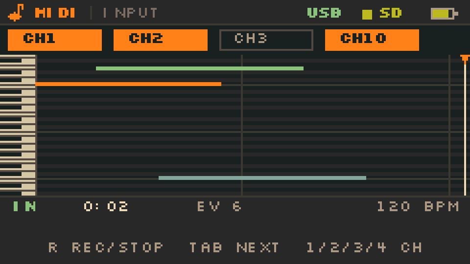

# Cardputer MIDI Player — v0.5.0 Cheat Sheet

> M5Stack Cardputer-Adv · 240×135 · Gruvbox Dark · 一根 USB-C 本地播放；可选 USB-C Host 直连 M-VAVE FM-1 / Sloop。

---

## 1. 30 秒上手

1. SD 卡格式 FAT32，把 `.mid` / `.midi` 放到 **`/midi/`**（没有该目录则扫描根目录）。
2. 插卡、上电；用 `Fn+;` / `Fn+.` 选文件，`Enter` 播放。
3. `Space` 暂停/继续，`Backspace` 回列表。
4. `Tab` 打开钢琴卷帘；`[` / `]` 拖动进度。
5. 音量先设 68–78；1 W 喇叭在更高音量可能失真。

```text
MIDI 播放器： dist/CardputerMidiPlayer-8MB.bin
USB-C Host：  dist/CardputerMidiPlayer-USBHost-8MB.bin
```

---

## 2. 按键

方向键是 `Fn` 层：

```text
        Fn + ;   = 上
Fn + ,  = 左      Fn + /  = 右
        Fn + .   = 下
```

### 全局

| 键 | 动作 |
|---|---|
| `-` / `=` | 音量 −10 / +10（所有界面） |

### 列表 / Library

| 键 | 动作 |
|---|---|
| `Fn+;` / `Fn+.` | 上 / 下 |
| `Enter` / `Space` | 进目录 / 播放文件 |
| `Fn+,` / `Backspace` | 返回上级 |
| `Fn+/` | 进入选中的目录 |

### 播放 / Player

| 键 | 动作 |
|---|---|
| `Space` / `Enter` | 播放 / 暂停；结束后重播 |
| `[` / `]` | 进度 −1 s / +1 s |
| `Fn+,` / `Fn+/` | 进度 −5 s / +5 s |
| `Fn+;` / `Fn+.` | 音量 +5 / −5 |
| `Tab` | 切换到钢琴卷帘 |
| `,` / `.` | 上一首 / 下一首 |
| `L` | 循环开 / 关 |
| `Fn+[` / `Fn+]` | 倍速 −0.1 / +0.1（仅普通 build；Host build 由 FM-1 BPM 接管） |
| `Backspace` | 停止并回列表 |

### 钢琴卷帘 / Roll

| 键 | 动作 |
|---|---|
| `Tab` | 切回播放页 |
| `Backspace` | 切回播放页 |
| `[` / `]` | 进度 −1 s / +1 s |
| `Fn+,` / `Fn+/` | 进度 −5 s / +5 s |
| `Fn+;` / `Fn+.` | 音量 +5 / −5 |
| `,` / `.` | 上一首 / 下一首 |
| `L` | 循环开 / 关 |

### MIDI INPUT（Host build）

| 键 | 动作 |
|---|---|
| `1` / `2` / `3` / `4` | 选择/取消 CH1 / CH2 / CH3 / CH10 |
| `R` / `Enter` / `Space` | 开始 / 停止录音并保存 |
| `Tab` | 回播放页；录音中先停止并保存 |
| `Backspace` | 回播放页；录音中先停止并保存 |

> 固件没有按键连发；`Fn+,` / `Fn+/` 的 ±5 s 也是一次一步。

---

## 3. 界面读法

| 位置 | 含义 |
|---|---|
| 顶栏 `SD` | 绿 = 卡正常；红 = 无卡 |
| 顶栏 `USB`（Host build） | 红 = Host 初始化失败；黄 = 设备已枚举但没有 MIDI OUT；灰 = 等待 FM-1；绿 = 已连接 |
| `PLAYING` / `PAUSED` / `ENDED` | 播放状态 |
| `VOX 03/24` | 当前声部数 |
| `PED` | 延音踏板 |
| `LIVE` | 当前按下的音符 |
| `x1.0` | 普通 build 的倍速 |
| `F120` | Host build 已锁定 FM-1 的 120 BPM |
| `B66` | Host build 没收到 FM-1 clock，按文件 66 BPM |
| 卷帘 `[ ] SEEK TAB PLAYER` | `[` / `]` 拖动进度，`Tab` 回播放页 |

---

## 4. MIDI INPUT（Host build）



Host build 的 `Tab` 循环：

```text
PLAYER → PIANO ROLL → MIDI INPUT → PLAYER
```

输入源是 **FM-1 自己的键盘/sequencer**（USB MIDI OUT）；外接键盘插 FM-1 的 TRS MIDI IN **不会**被 Sloop 回传，不能在 Cardputer 上录到。

| 键 | 动作 |
|---|---|
| `1` / `2` / `3` / `4` | 选择/取消 CH1 / CH2 / CH3 / CH10（至少保留一个） |
| `R` / `Enter` / `Space` | 开始 / 停止录音 |
| `Tab` | 回播放页；录音中会先停止并保存 |
| `Backspace` | 回播放页；录音中会先停止并保存 |

- 实时钢琴卷帘只显示选中的通道；
- 停止后写入：
  ```text
  /midi/MyMIDI/TAKE_0001.MID
  /midi/MyMIDI/TAKE_0002.MID
  ```
- Format 0、480 PPQ、单轨；当前 BPM 的 tempo；录 Note On/Off、CC64；
- 最多 **6000 个事件**；满了自动停止并保存；
- Sloop 发 sequencer：`GLO → MIDI 2 → OUT = SEQ`；只弹键盘用 `OUT = KEYS`。

---

## 5. USB-C Host → FM-1（实验）

Host build 没有 USB-CDC 串口；调试看屏幕或 SD 根目录 **`/usb.log`**。

### 刷写

```bash
# 1) 断开 FM-1，Cardputer 单独接 PC
# 2) 按住 G0 进下载模式，确认 COM 口
pwsh tools/flash_usbhost.ps1 -Port COMx
```

刷完脚本会停在 ROM loader：

1. **先拔掉 PC 的 USB-C**；
2. 断电重开 Cardputer；
3. 用 USB-C 数据线接 FM-1（FM-1 用自身电池）。

> **不要在 Host 固件运行时同时接 PC**，避免两边同时供 5V。

### Sloop 设置

```text
GLO → MIDI       CH1=1  CH2=2  CH3=3  CH4=10
GLO → MIDI 2     IN=NOTES   OTHER=SEL 或 OFF
GLO → MIDI 3     CLOCK=OUT
SYNC=INT
DR MAP=GM
ARP 2 → HOLD=OFF
```

- Host build 发送 Note On/Off、CC64、All Notes Off；不发送 Program Change。
- **channel 10 鼓**会原样转发，Sloop 用 `DR MAP=GM` 对应。
- **暂停挂音先检查 Sloop 的 `KBD HOLD`**：HOLD ON 会锁住 MIDI 音符，Cardputer 的 Note Off 无法释放。
- BPM 跟随需要 Sloop 从 USB 发 clock；显示 `F...` 才成功。

### Host 状态日志

```text
/usb.log
host=ok
device seen=1 midi=1 vid=xxxx pid=xxxx ep=xx in=xx
FM1 connected
bpm=F120 in=81 clock=1
pause=1 panicNotes=3 active=0
```

- `in=00`：没找到 FM-1 MIDI IN，BPM 收不到。
- `pause ... panicNotes=0`：Cardputer 活动表里没有该音，优先查 Sloop HOLD/ARP/SEQ。

### 恢复普通 build

```bash
# 断开 FM-1，Cardputer 接 PC，按住 G0 进下载模式
pwsh tools/flash_normal.ps1 -Port COMx
```

---

## 6. 串口控制台（普通 build，115200）

| 字符 | 动作 |
|---|---|
| `p` / 空格 | 列表播放；播放页暂停/继续 |
| `n` | 下一首 |
| `b` | 停止回列表 |
| `+` / `-` | 音量 ±5 |
| `l` | 循环 |
| `[` / `]` | 进度 −1 s / +1 s |
| `<` / `>` 或 `,` / `.` | 速度 ±0.1 |
| `0` / `1` / `2` / `3` | 速度 0.1 / 1.0 / 2.0 / 3.0 |
| `t` | 播放页 ↔ 卷帘 |
| `i` | 状态：screen/pos/cpu/ur/voices/vol/spd/heap |
| `h` / `?` | 帮助 |

Host build **没有这个串口**；用屏幕和 `/usb.log`。

---

## 7. SD 卡与限制

```text
/midi/
  song.mid
  song2.midi
  ...
/usb.log        # Host build 自动生成
```

- 支持 SMF Format 0 / 1；SMPTE、Format 2 拒绝。
- 最多 **14000 个事件**（note on/off + CC64），超过提示 `TOO COMPLEX`。
- MIDI INPUT 最多 **6000 个事件**；满 6000 自动停止并保存。
- 最大 64 个列表项；文件名超过 26 字符会截断显示。
- 中文文件名会显示为 `?`，但文件仍可打开。
- 本地音色是 **2 泛音合成钢琴**，不是采样钢琴；耳机明显好于 1 W 喇叭。
- Host build 的 USB 音频接口被忽略，只使用 MIDIStreaming。
- MIDI INPUT 只录 FM-1 自己的键盘/sequencer；Sloop 不把外部 TRS MIDI IN 回传。

---

## 8. 排障

| 现象 | 处理 |
|---|---|
| 没有声音 | 音量、耳机/喇叭、`codec=1`；`ur` 是否增长 |
| 没有文件 | SD FAT32；文件放 `/midi/`；`Backspace` 重扫 |
| `TOO COMPLEX` | 文件事件数 >14000，换短编曲 |
| 暂停后 FM-1 挂音 | 先设 Sloop `ARP 2 → HOLD=OFF`；再查 `/usb.log` 的 `pause=` |
| MIDI INPUT 没音符 | FM-1 要 `OUT=KEYS/SEQ`；外接键盘插 FM-1 TRS 不会回传 |
| MIDI INPUT 保存失败 | SD 卡可写、`/midi/MyMIDI` 可创建；最多 6000 事件 |
| Host 显示 `B...` | Sloop 没开 `CLOCK=OUT`，或 `in=00` |
| USB 黄/灰/红 | 黄=无 MIDI OUT；灰=未枚举；红=Host 初始化失败 |
| 电脑看不到 Host 串口 | 正常：Host build 没有 USB-CDC；用 `/usb.log` |
| 想恢复串口 | G0 下载模式 + `flash_normal.ps1` |
| 音量 >78 破音 | 1 W 喇叭/功放上限；降到 68 或接耳机 |

---

## 9. 版本与文件

- **Release：** v0.4.0（v0.5.0 MIDI INPUT 为 beta）
- **普通镜像：** `dist/CardputerMidiPlayer-8MB.bin`（0x0）
- **Host 镜像：** `dist/CardputerMidiPlayer-USBHost-8MB.bin`（0x0）
- **录音目录：** `/midi/MyMIDI/TAKE_xxxx.MID`
- **校验：** `dist/SHA256SUMS.txt`
- **仓库：** https://github.com/saxon267/Cardputer_MidiPlayer
- **详细文档：** [firmware/README.md](firmware/README.md) · [可行性评估.md](可行性评估.md)

> Host 直连 FM-1 仍是实验功能；正常播放器、钢琴卷帘、倍速/音量与串口控制台是稳定部分。
