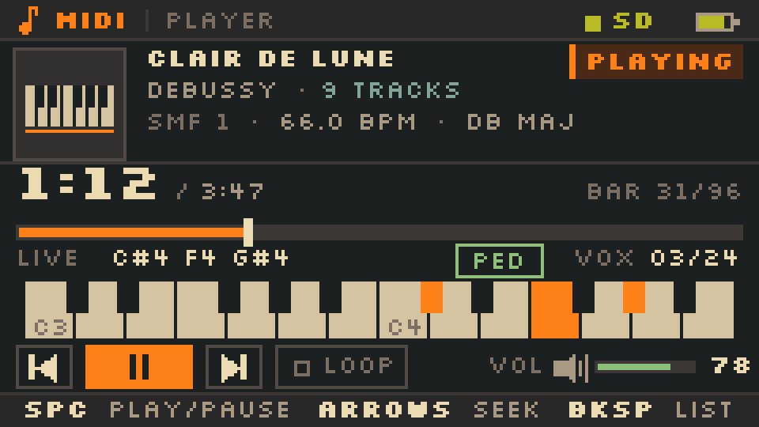
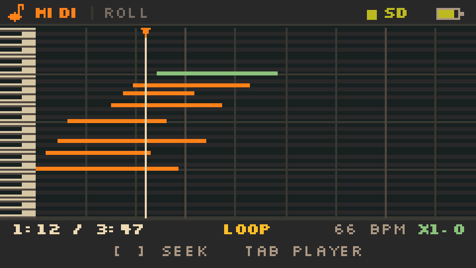
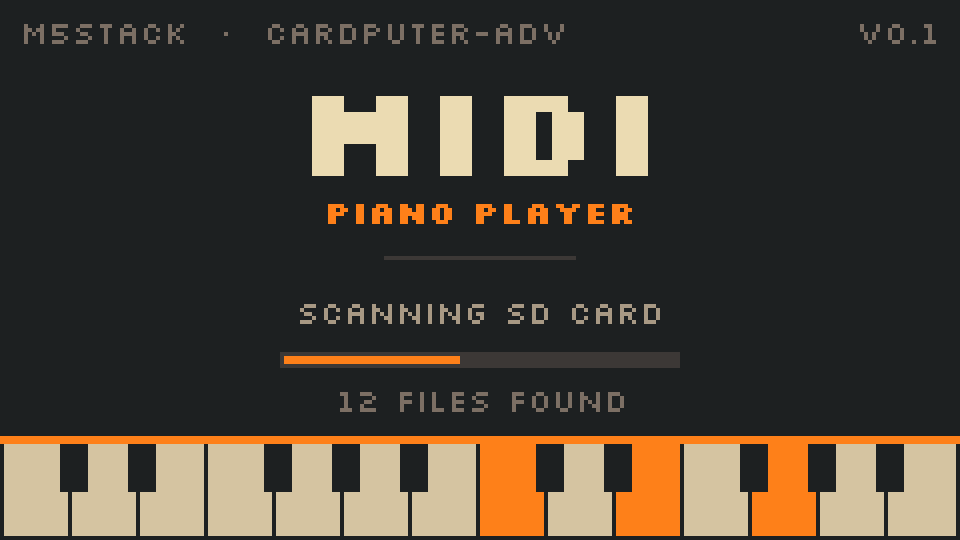
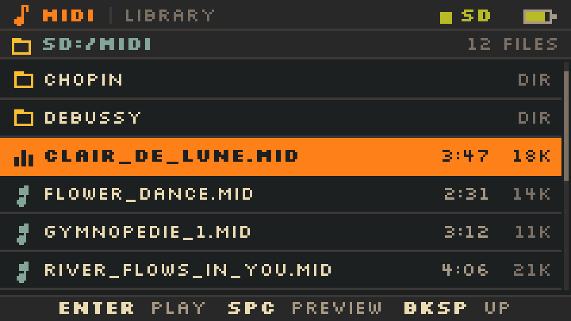
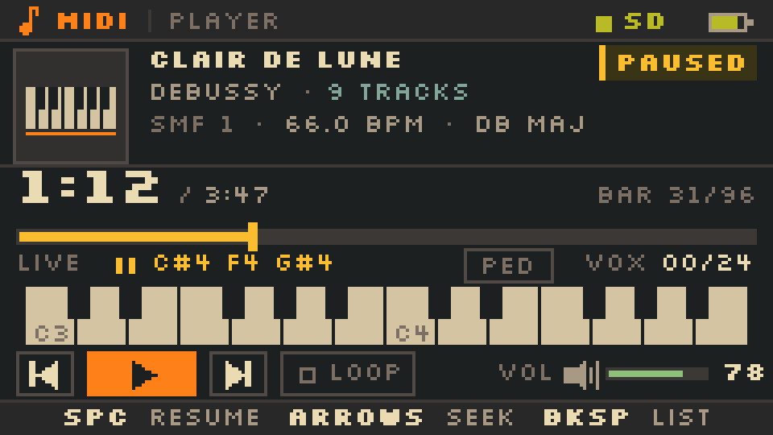
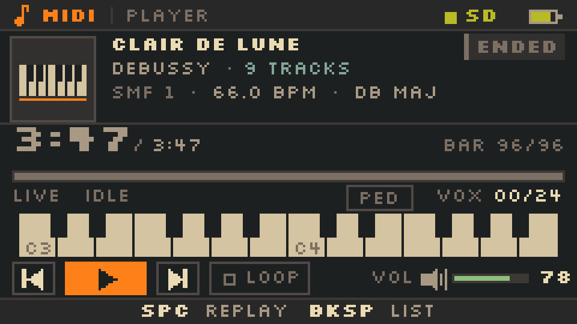
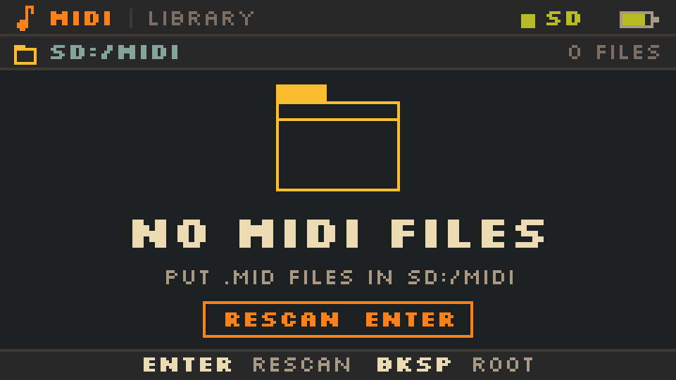
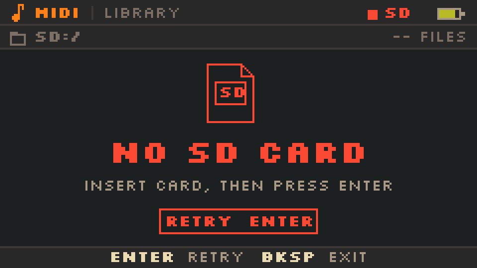

<p align="center">

</p>

# MIDI Piano — M5Stack Cardputer-Adv

把 SD 卡里的 `.mid` 播成钢琴声：一个 240×135、Gruvbox Dark 的随身 MIDI 播放器。

> **v0.2.1 固件已上机验证启动/播放/CPU/无欠载**：24 声部 / 2 泛音 1x CPU 19–21%、3x 约 40%，`ur=0`；新增 **0.1–3.0 倍速** 和 **动态钢琴卷帘**。串口日志与修复记录见 [`firmware/README.md`](firmware/README.md)。
> 设计评估仍有效；Phase 2（4 MB Flash 采样钢琴）尚未实现。

| | |
|---|---|
| 目标机 | M5Stack Cardputer-Adv（ESP32-S3FN8，512 KB SRAM，8 MB Flash，**无 PSRAM**） |
| 音频 | ES8311 单声道 + NS4150B 1 W；3.5 mm 单声道耳机 |
| 屏幕 | 240×135 IPS，1.14" |
| v0.2.1 固件 | SMF Format 0/1 + 24 声部 / 2 泛音合成钢琴 + 44.1 kHz 直连 I2S |
| Phase 2 | 4 MB Flash 多采样钢琴（18 区 / 22.05 kHz / 16-bit） |
| 工作量 | 合成版 MVP 60–90 h；采样版 110–160 h |
| 音质 | 便携琴级别，不是钢琴；耳机明显更好 |

## 固件 v0.2.1

**功能**：SD `/midi`（回退 `/`）、文件夹、`.mid` / `.midi`、Format 0/1、tempo、CC64 延音、24 声部钢琴、播放/暂停、`Fn+,` / `Fn+/` seek ±5 s、`[` / `]` seek ±1 s、0.1–3.0 倍速、Tab 切换动态钢琴卷帘、上一首/下一首、循环、音量/速度 NVS、8 个 Gruvbox 界面。

**限制**：最多 14000 个事件（约 7000 个音符）；合成音色；无按键连发；无中文文件名。



```bash
cd firmware
pio run                 # 编译
pio run -t upload       # USB-C 刷写
pio device monitor      # 115200
```

合并镜像：`pwsh tools/make_bin.ps1` → `dist/CardputerMidiPlayer-8MB.bin`（从 `0x0` 烧写）。

测试文件：`python firmware/tools/make_test_midi.py` → `firmware/assets/test.mid`；放进 SD 的 `/midi/`。

详细按键、串口排障、内存与实现结构见 **[firmware/README.md](firmware/README.md)**。

## 文档

- **[可行性评估](可行性评估.md)** — 硬件约束、系统架构、MIDI 解析与定时、三种音源对比、RAM/Flash/CPU 预算、风险、里程碑、验收标准
- **[UI 规格](design/ui-spec.md)** — 240×135 像素级坐标、Gruvbox 色板、组件、状态机、按键、刷新策略
- **[资源预算图](docs/midi-budget.png)** — SRAM / Flash / 延迟一页看懂

## 界面

7 个界面 / 状态（总览图 7 个 + 控制卡）：

<p>




</p>

<p><em>扫描 · 文件列表 · 播放（大号时间 + 实时键盘）· 暂停（黄色）</em></p>

<p>



</p>

<p><em>结束（灰）· 无文件 · 无卡（红）</em></p>

全部界面：[`design/out/00-overview.png`](design/out/00-overview.png) · 调色板：[`design/out/palette.png`](design/out/palette.png)

## 关键结论

1. **能播。** MIDI 解析是小事；难点是“24 个声部稳定喂给 ES8311”和“4 MB Flash 里的钢琴采样听起来像钢琴”。
2. **采样不要放 RAM。** 512 KB 无 PSRAM，22.05 kHz / 16-bit 单声道 3 分钟就是 7.9 MB；必须放 Flash、mmap 直接读。
3. **不要从 SD 实时流采样。** 卡内 GC 一次 100–250 ms，24 声部会炸；整首预扫描 + Flash 采样才稳。
4. **合成钢琴只做 Phase 1。** v0.1 已用它跑通解析/调度/暂停/seek/UI；最终音色必须换采样。
5. **暂停不要 `Speaker.stop()`。** 继续跑静音块，恢复从原位置继续；v0.1 是硬切，后续补 5 ms 淡入淡出。

## 复现设计稿

```bash
pip install pillow
python design/render_ui.py     # -> design/out/*.png
python docs/make_budget.py     # -> docs/midi-budget.png
```

设计稿用 Pillow 在 **真实 240×135 画布**上 1× 绘制，单屏最近邻放大 4×、总览 2×；字体 Silkscreen（SIL OFL 1.1，见 `design/fonts/OFL.txt`）。

## 目录

```
Cardputer_MIDI/
├── 可行性评估.md
├── README.md
├── design/
│   ├── ui-spec.md
│   ├── render_ui.py
│   ├── fonts/            Silkscreen + OFL
│   └── out/              7 屏 + 总览 + 调色板
├── docs/
│   ├── make_budget.py
│   └── midi-budget.png
├── firmware/
│   ├── README.md
│   ├── platformio.ini
│   ├── partitions.csv
│   ├── src/              main / midi / audio / ui / library / font8
│   ├── assets/test.mid
│   └── tools/            gen_font.py / make_test_midi.py
└── tools/
    └── make_bin.ps1
```
