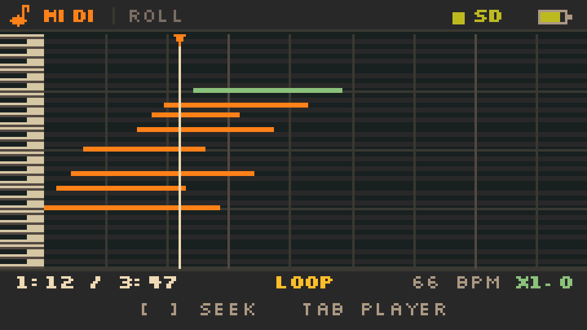
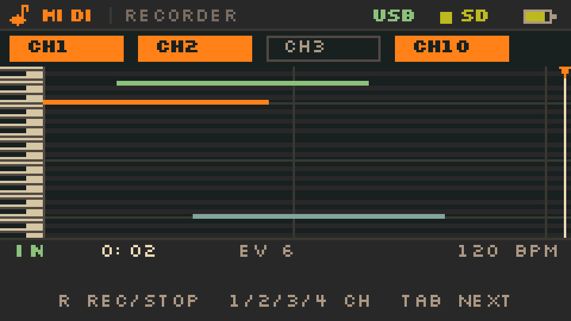

# Cardputer-Adv MIDI Player — UI 规格 v1.0

> 设备：M5Stack Cardputer-Adv，240×135 IPS，56 键，单声道。
> 风格：Gruvbox Dark，1 px 描边，8 px 栅格，无圆角 / 渐变 / 抗锯齿。
> 设计稿：`out/*.png`（4× 最近邻放大）；本文所有尺寸为 **1× 设备像素**。
> 渲染脚本：`design/render_ui.py`（Pillow + Silkscreen），本文坐标与脚本一一对应。

---

## 1. 画布与栅格

- 画布 240×135，横屏；原点左上。
- 顶部状态栏 13 px（0–12），底部提示栏 11 px（124–134），中间内容 111 px（13–123）。
- 所有坐标取整数；控件高度尽量 4 的倍数；1 px 分隔线不算在内容高度里。
- 8 px 字体：Regular 字符步进 6 px，大写高 5 px，行距 10 px；一行最多 40 字符（Bold 更宽，按实测宽度排版）。
- 16 px 字体：步进 12 px，大写高 10 px；32 px：步进 24 px，高 20 px。

### 1.1 播放页纵向分区

| 区域 | Y 范围 | 高度 | 说明 |
|---|---:|---:|---|
| 顶栏 | 0–12 | 13 | 品牌、页面名、SD、电量 |
| 曲目头 | 13–50 | 38 | 图块 + 三行元信息 + 状态徽标 |
| 分隔线 | 51 | 1 | `LINE` |
| 进度 | 52–76 | 25 | 大号时间、进度条、小节号 |
| 实时 | 77–88 | 12 | LIVE 文本 y=79，PED 框 77–87 |
| 键盘 | 89–107 | 19 | 键面 89–106（18 px），2 个八度 |
| 走带 | 108–123 | 16 | 按钮 109–122（14 px） |
| 底栏 | 124–134 | 11 | 按键提示 |

---

## 2. 色彩

| Token | Hex | RGB565 | 用途 |
|---|---|---|---|
| `BG` | `#1D2021` | `0x1904` | 页面底色（dark0_hard） |
| `BAR` | `#282828` | `0x2945` | 顶栏 / 底栏（dark0） |
| `PANEL` | `#282828` | `0x2945` | 路径条 / 面板（同 BAR） |
| `PADBG` | `#32302F` | `0x3185` | 图块、未激活控件底（dark0_soft） |
| `EDGE` | `#504945` | `0x5248` | 控件描边（dark2） |
| `LINE` | `#3C3836` | `0x39C6` | 分隔线（dark1） |
| `TXT` | `#EBDBB2` | `0xEED6` | 主文字（light1） |
| `LT2` | `#D5C4A1` | `0xD634` | 钢琴白键（light2） |
| `DIM` | `#A89984` | `0xACD0` | 次文字（light4） |
| `FAINT` | `#7C6F64` | `0x7B6C` | 提示、禁用（dark4） |
| `ACC` | `#FE8019` | `0xFC03` | 走带 / 选中 / 正在播放（bright orange） |
| `ACC_DIM` | `#4A2A17` | `0x4942` | 橙色徽标底 |
| `AMB` | `#FABD2F` | `0xFDE5` | 暂停、警告（bright yellow） |
| `AMB_DIM` | `#3A3417` | `0x39A2` | 黄色徽标底 |
| `AQUA` | `#8EC07C` | `0x8E0F` | 延音踏板、音量（bright aqua） |
| `BLUE` | `#83A598` | `0x8533` | 文件、路径、元信息（bright blue） |
| `PURPLE` | `#D3869B` | `0xD433` | 预留（多轨配色，v1 不用） |
| `RED` | `#FB4934` | `0xFA46` | 错误、无卡（bright red） |
| `GREEN` | `#B8BB26` | `0xBDC4` | SD 正常、电量（bright green） |

**语义规则**

- 橙色只表示“走带 / 选中 / 正在播放”，不要拿它表示“正常”。
- 黄色只表示“暂停 / 需要注意”，绿色只表示“SD / 电量正常”。
- 红色只用于错误，且必须同时有文字（`NO SD CARD`、`BAD MIDI`），不单独用颜色。
- 一屏最多一个橙色实心大块（播放键或选中行），避免注意力分散。

---

## 3. 字体

| 用途 | 字体 | 大小 | 备注 |
|---|---|---|---|
| 正文 / 标签 / 按钮 | Silkscreen Regular | 8 px | 全大写；6 px 步进；5 px 大写高 |
| 强调 / 文件名 / 数值 | Silkscreen Bold | 8 px | 5 px 高；步进 6–7 px（比 Regular 宽，排版用 `textWidth()` 实测） |
| 大号时间 | Silkscreen Bold | 16 px | 12 px 步进；10 px 高 |
| 开机标题 | Silkscreen Bold | 32 px | 24 px 步进；20 px 高 |

- Silkscreen 采用 SIL OFL 1.1，`fonts/OFL.txt`。
- 转成 M5GFX `GFXfont`（1 bpp）后放入 Flash；普通/粗体各一套。若用 M5GFX 内置 `Font0`，步进会变成 6×8 且字形不同，版式需要重算。
- 绘制辅助：以“大写顶部”为 y 传入，内部偏移 `-4`（8 px）/`-7`（16 px）/`-13`（32 px），与设计稿一致。
- 数字等宽，时间 / BPM / 声部数不会因数字变化而左右跳。

---

## 4. 组件

### 4.1 顶栏

| 元素 | 位置 | 尺寸 |
|---|---|---|
| 音符 logo | (5,2) | 9×9，`ACC` |
| `MIDI` 字标 | (17,4) | 8 px Bold，`ACC` |
| 竖分隔 | x=46, y=3–9 | 1×7，`LINE` |
| 页面名 `LIBRARY` / `PLAYER` | (52,4) | 8 px，`FAINT` |
| SD 状态方块 | (185,5) | 5×5，绿/黄/红 |
| `SD` | (193,4) | 8 px Bold，同色 |
| 电量 | (220,4) | 12×6 + 2×2 触点；3 段填充 |

电量：>70% 8 px 绿，35–70% 5 px 绿，<35% 2 px 红；边框 `DIM`。

### 4.2 状态徽标

- 高度 11，右对齐到 x=235，y=14。
- 宽 = 文本宽 + 8；左侧 2 px 竖条为主题色，文本 8 px Bold。
- 播放：`PLAYING` / `ACC` on `ACC_DIM`；暂停：`PAUSED` / `AMB` on `AMB_DIM`；结束：`ENDED` / `FAINT` on `PADBG`；加载：`LOADING` / `BLUE` on `PADBG`；错误：`BAD MIDI` / `RED` on `PADBG`。

### 4.3 进度条

- 轨道 (5,71) 230×5，`LINE`；填充内缩 1 px，`ACC`（暂停 `AMB`，结束 `FAINT`）。
- 播放头：3×9，位于 `x = 5 + 230 × ratio`，`TXT`（暂停 `AMB`）。
- 不画刻度；小节号用文字放右侧。
- 进度每 100 ms 更新一次即可；拖动（未来）另做。

### 4.4 实时键盘

- 区域 (8,89) 224×18；14 个白键 × 16 px，`LT2`；白键之间 1 px `BG` 分隔。
- 黑键 7×10，`BG`；位于白键边界，左移 4 px（`bx = boundary - 4`）。
- 按下的白键 / 黑键填充 `ACC`；白键上的 `C3` / `C4` 标签在 (10,101) / (122,101)，按下时文字 `BG`，否则 `FAINT`。
- 音域窗口 C3–B4（MIDI 48–71）；当前音符超出时按八度平移窗口，200 ms 迟滞，保证至少一个按下的键可见。
- 暂停/结束：全部不亮；暂停时在 LIVE 行用黄色 `II` + 音符名表示“保持但静音”。

### 4.5 走带按钮

| 控件 | 位置 | 尺寸 | 样式 |
|---|---|---|---|
| 上一首 | (5,109) | 18×14 | `EDGE` 描边，`TXT` 图标 |
| 播放/暂停 | (27,109) | 34×14 | `ACC` 实心，`BG` 图标 |
| 下一首 | (65,109) | 18×14 | `EDGE` 描边 |
| LOOP | (87,109) | 42×14 | 描边；5×5 复选框 (93,114)，文字 (102,113) |
| VOL | (154,113) 文本 | 8 px | `FAINT` |
| 音量图标 | (175,112) | 11×8 | `DIM` |
| 音量条 | (188,114) | 32×4 | 轨道 `LINE`，填充 `AQUA` |
| 音量值 | (224,113) | 8 px Bold | `TXT` |

- 播放中显示 `II`，暂停/结束显示 `▶`；图标居中，不随状态改按钮尺寸。
- LOOP 开：复选框填 `ACC`、文字 `ACC`、底 `ACC_DIM`、描边 `ACC`；关：空心 `FAINT`。
- 按钮不使用圆角；按下态（如果有）只做 1 px 内缩，不加阴影。

### 4.6 列表行

- 行高 16，y0=26，6 行；行底 1 px `LINE`（选中行不画）。
- 选中：整行 236×16 填 `ACC`，前景 `BG`。
- 图标 (6,y+4) 8×8；文件名 (18,y+5)，8 px（选中 Bold）。
- 时长右对齐 206，大小右对齐 232；文件夹在大小列显示 `DIR`。
- 正在播放但不是选中行：文件名 `ACC`，图标换成 3 根小柱子（`ACC`）。
- 滚动条 x=237，宽 2，y=26–121；轨道 `PADBG`，滑块 `FAINT`，高度按比例（最小 8）。

### 4.7 底部提示

- 背景 `BAR`，上边线 y=124 `LINE`，文字 y=127。
- 每组 = 键名（8 px Bold `TXT`）+ 6 px + 动作（8 px `DIM`）；组间距 8 px；整组水平居中。
- 例：`SPC PLAY/PAUSE` `ARROWS SEEK` `BKSP LIST`。
- 不使用带下伸部的键名（逗号、句号）作为提示，避免 5 px 字底被裁；方向键提示统一写 `ARROWS`。

---

## 5. 屏幕

### 5.1 开机 / 扫描（`01-splash.png`）

```
(5,6)   M5STACK · CARDPUTER-ADV        (235,6) V0.1
(120,24) MIDI                            32 px Bold，居中
(120,51) PIANO PLAYER                    8 px Bold，ACC
(96,64) 48×1 LINE
(120,76) SCANNING SD CARD                8 px，DIM
(70,88) 100×4 进度条                     45% 示例
(120,98) 12 FILES FOUND                  8 px，FAINT
(0,109) 240×2 ACC                        琴键上的“毛毡条”
(1,111) 14 个白键 × 17，高 23            C3–B4，按下的键 ACC
```

- 扫描 <600 ms 也至少显示 600 ms，避免闪屏。
- 扫描超过 1.5 s：进度条改为 30% 宽块来回滑动（不确定态），文字保持 `SCANNING SD CARD`。

### 5.2 文件列表（`02-library.png`）

| 元素 | 坐标 |
|---|---|
| 路径条 | (0,13) 240×12，`PANEL`；底边 y=24 `LINE` |
| 文件夹图标 | (5,16) 8×8，`AMB` |
| 路径 | (17,16) 8 px Bold，`BLUE` |
| 文件数 | 右对齐 235, y=16，`FAINT` |
| 列表 | y=26，6×16 |
| 底栏 | 见 §4.7 |

- 路径超过 28 字符：从左侧省略，显示 `..` + 末段，例如 `.. /CHOPIN/NOCTURNES`。
- 空目录仍然显示路径条与 `0 FILES`，然后进入空状态（5.6）。
- 返回列表时保持滚动位置和选中项。
- 排序：文件夹在前，然后按名称不区分大小写；**不显示 `..` 行**，用 `BKSP` / `Fn+,` 返回上级，路径条始终显示当前位置。
- 时长不是开机全量扫描：选中行时后台预扫描一次（30–100 ms），结果按 `路径 + mtime` 缓存到 NVS；没扫过的行显示 `--:--`，不阻塞列表。

### 5.3 播放（`03-player.png`）

| 元素 | 坐标 / 值 |
|---|---|
| 图块 | (4,15) 36×36，`PADBG` 底 + `EDGE` 边；内部 7 白键 × 4 px，黑键 3×7；底部 (8,41) 28×1 `ACC` |
| 曲名 | (46,16) 8 px Bold，`TXT`，最多 22 字符后走马灯 |
| 第二行 | (46,26) `DEBUSSY · 9 TRACKS`；作曲家 `DIM`，点 `FAINT`，轨道数 `BLUE` |
| 第三行 | (46,36) `SMF 1 · 66.0 BPM · DB MAJ`；标签 `FAINT`，数值 `DIM` |
| 徽标 | 右对齐 235，y=14（§4.2） |
| 分隔线 | y=51，240×1 `LINE` |
| 大号时间 | (5,53) 16 px Bold |
| `/ 总时长` | (55,58) `/`，`FAINT`；(63,58) 总时长，`DIM` |
| 小节号 | 右对齐 235, y=58，`FAINT`，`BAR 31/96` |
| 进度条 | (5,71) 230×5（§4.3） |
| LIVE | (5,79) `FAINT` |
| 当前音符 | (35,79) `TXT`，例 `C#4 F4 G#4`；超过 4 个显示 `+N` |
| PED | (144,77) 28×11 描边；文字 (149,80)；踩下 `AQUA`，否则 `EDGE`/`FAINT` |
| VOX | (181,79) `FAINT` + (205,79) `03/24` `TXT` |
| 键盘 | (8,89) 224×18（§4.4） |
| 走带 | §4.5 |
| 底栏 | `SPC PLAY/PAUSE` `ARROWS SEEK` `BKSP LIST` |

- `DB MAJ` 是调号 meta；没有调号时显示 `KEY --`，不要猜。
- BPM 是当前 tempo；tempo 变化时数字跟着变，不四舍五入到整数。
- `9 TRACKS` 是文件头里的轨道总数；单轨文件显示 `1 TRACK`。
- 图块是“专辑图”的占位：MIDI 没有封面，所有文件共用钢琴图块，不按文件名随机生成，避免花哨。

### 5.4 暂停（`04-paused.png`）

- 徽标 `PAUSED`（`AMB` on `AMB_DIM`）。
- 进度条填充与播放头变 `AMB`。
- 播放键变 `▶`。
- LIVE 行：`II`（两个 2×5 `AMB` 竖条，x=36/40）+ 保持的音符名（`AMB`，x=47）。
- 键盘全灭；`PED` 若在按下状态仍显示 `AQUA`，否则 `EDGE`。
- 底栏：`SPC RESUME` `ARROWS SEEK` `BKSP LIST`。
- 不放整屏遮罩：暂停时用户仍需要看时间、音符、BPM。

### 5.5 结束（`05-ended.png`）

- 徽标 `ENDED`（`FAINT` on `PADBG`）。
- 大号时间 `DIM`，进度条 `FAINT` 满格，播放头隐藏。
- 小节号 `BAR 96/96`；LIVE 显示 `IDLE`；VOX `00/24`。
- 播放键显示 `▶`；底栏 `SPC REPLAY` `BKSP LIST`。
- 不自动下一首；循环开启时回到 0 继续（徽标仍 `PLAYING`）。

### 5.6 空状态：没有 MIDI 文件（`06-no-files.png`）

```
(98,30)  18×7  AMB   文件夹标签
(98,36)  44×32  AMB 描边
(99,42)  42×1  AMB   内折线
(120,78) NO MIDI FILES       16 px Bold，TXT
(120,96) PUT .MID FILES IN SD:/MIDI   8 px，DIM
(72,107) 96×13  ACC 描边 + "RESCAN  ENTER" 8 px Bold
底栏    ENTER RESCAN   BKSP ROOT
```

### 5.7 空状态：没有 SD 卡（`07-no-sd.png`）

```
(104,32) 24×30  RED  SD 卡轮廓 + 切角，内部 16×12 标签框 + "SD"
(120,72) NO SD CARD          16 px Bold，RED
(120,91) INSERT CARD, THEN PRESS ENTER   8 px，DIM
(80,105) 80×13  RED 描边 + "RETRY  ENTER"
顶栏    SD 方块与 "SD" 变红
底栏    ENTER RETRY   BKSP EXIT
```

## 5.1 钢琴卷帘（v0.2.0）



- 顶部状态栏：`MIDI | ROLL`，SD / 电量沿用。
- 主区域 y=14..109：左侧 18 px 竖向键盘，右侧 222×96 网格。
- 曲内时间窗 **8 s**：播放头在左侧 1/4（过去 2 s，未来 6 s）；到曲首/曲尾时窗口夹紧。
- 纵向 **48 个半音**（2 px/半音），根据窗口内可见音符自动定中心，并以每帧最多 4 行平滑移动。
- 音符：当前音 `ACC` 橙、未来按通道 `AQUA`/`BLUE`、过去 `FAINT`；每八度一条 `LINE` 横线。
- 网格：按当前 BPM 画拍线，4 拍一条 `EDGE` 小节线。
- 底部 24 px：`时间 / 总时长`、`LOOP`、`BPM`、`x1.0`；第二行 `[ ] SEEK   TAB PLAYER`。

## 5.2 MIDI INPUT（v0.8.2，Host build）



- 顶部状态栏：`MIDI | INPUT`，SD / 电量 / USB 沿用。
- 通道选择条 y=14..26：`CH1` / `CH2` / `CH3` / `CH10`，选中为 `ACC` 填充，未选为 `EDGE` 框。
- 主区域 y=28..100：左侧 18 px 键盘，右侧 36 个半音（2 px/半音）实时卷帘；8 s 窗口。
- 音符按通道着色：CH1 `ACC`、CH2 `AQUA`、CH3 `AMB`、CH10 `BLUE`。
- 播放头在右侧；录音中卷帘从右向左滚动。
- 底部 y=101..134：`REC`/`IN`/`TAKE`、时间、`EV n`、`BPM`、`R REC/STOP TAB NEXT 1/2/3/4 CH`。
- 未连接 FM-1：显示 `CONNECT FM1 USB`；无事件：`PRESS R TO RECORD`。
- 停止后写 `/midi/MyMIDI/<PREFIX>_xxxx.MID`，并弹保存路径；前缀按所选通道（LEAD/PAD/BASS/DRUM）。

---

## 6. 状态机

```
BOOT → SPLASH/SCAN ─┬─ 有卡有文件 → LIBRARY ⇄ PLAYER
                    ├─ 有卡无文件 → NO_FILES
                    └─ 无卡       → NO_SD
PLAYER ── Space/Enter ──▶ PLAYING ⇄ PAUSED
   │                        │
   │                        └─ 曲末 → ENDED ── Space → PLAYING(from 0)
   ├─ Backspace → LIBRARY（停止，15 ms 淡出）
   ├─ , / . → 上一首/下一首（LOADING → PLAYING）
   └─ 打开失败 → LIBRARY + 1.2 s 红色 toast
```

- **加载**：解析 + 预扫描；超过 150 ms 显示 `LOADING` 徽标。加载期间按钮不响应（除 Backspace 取消）。
- **返回列表**：保留选中项和滚动位置；正在播放的文件行保持橙色标记。
- **错误**：文件损坏 / 格式不支持 / 无音符 / 音符超 50k → 回列表，底栏上方 1.2 s toast（红色文字 + `PADBG` 底），不弹模态框。

---

## 7. 按键（完整）

| 场景 | 键 | 动作 | 连发 |
|---|---|---|---|
| 列表 | `Enter` | 进目录 / 播放 | — |
| 列表 | `Space` | 试听 8 s / 停止 | — |
| 列表 | `Fn+;` / `Fn+.` | 上 / 下 | 400 ms 后 12/s |
| 列表 | `Fn+,` | 上一级 | — |
| 列表 | `Fn+/` | 进目录 | — |
| 列表 | `Backspace` / `` ` `` | 上一级 / 根目录 | — |
| 播放 | `Space` / `Enter` | 播放 / 暂停 | — |
| 播放 | `Fn+,` / `Fn+/` | −5 s / +5 s | 400 ms 后 12/s |
| 播放/卷帘 | `[` / `]` | 进度 −1 s / +1 s | — |
| 播放/卷帘 | `Fn+[` / `Fn+]` | 速度 −0.1 / +0.1（0.1–3.0） | — |
| 播放 ⇄ 卷帘 | `Tab` | 切换界面 | — |
| 卷帘 | `Backspace` | 返回播放页 | — |
| 播放/卷帘 | `Fn+;` / `Fn+.` | 音量 +5 / −5 | 400 ms 后 12/s |
| 播放 | `,` / `.` | 上一首 / 下一首 | — |
| 播放 | `L` | 循环开 / 关 | — |
| 播放 | `Backspace` | 停止并返回 | — |
| 全局 | `-` / `=` | 音量 −10 / +10 | 按住连发 |

- Cardputer 的 `Fn` 是键盘层，不是独立键；用 `M5Cardputer.Keyboard.keysState().fn` 判断。
- 按键边沿检测：记录 `pressed` 位图，只在 0→1 时触发；`Fn` 组合键以“Fn 当前状态 + 字符键”解析。
- 音量变化在播放页更新音量条；在列表页弹 1.2 s OSD：底栏上方 100×13 的 `VOL 78`，`PADBG` 底 + `AQUA` 填充。
- 不做长按菜单；没有触摸。

---

## 8. 动效与刷新

| 元素 | 频率 | 方式 |
|---|---|---|
| 进度条 / 时间 | 10 fps | 局部 `pushSprite`，230×9 + 48×11 |
| 键盘按键 | 事件驱动 | 只刷变化的键（16×18 或 7×10） |
| LIVE 音符 | 事件驱动 | 35–105 × 8 区域 |
| 徽标 | 状态切换 | 右上 50×11 |
| 列表选择 | 按键驱动 | 整块 240×96（y=26–121），约 6 ms |
| 开机进度 | 30 fps | 100×4 |
| toast | 1.2 s | 底栏上方 100×13 |

- 不做淡入淡出 / 缓动 / 阴影；状态切换是瞬时的，只有音频做 5–10 ms 淡入淡出。
- 进度条不追帧：音频时钟是唯一真相，UI 只做显示。
- 全屏 sprite 240×135×16bpp = 64.8 KB；40 MHz SPI 全屏约 13 ms，所以 **禁止每帧全屏 push**。

---

## 9. 文案与溢出

| 位置 | 规则 |
|---|---|
| 曲名 | 最多 22 字符；超出以 30 px/s 走马灯，两端停 2 s；不要缩字号 |
| 列表文件名 | 可用 166 px（27 字符）；超出中间截断 `..`，保留扩展名 |
| 路径 | 从左侧省略，保留末两级 |
| 音符名 | 最多 4 个，`C#4 F4 G#4 B4`；更多显示 `+N` |
| 非 ASCII | v1 显示 `?`；底栏提示 `NON-ASCII NAME`；P2 加 CJK 字库 |
| 数字 | 固定宽度；BPM 保留 1 位小数；时间 `M:SS`，超过 1 h 用 `H:MM:SS` |
| 空值 | 调号 `KEY --`；轨道数 `-- TRACKS`；时长未知 `--:--` |

---

## 10. 实现映射（M5GFX）

- `M5Canvas canvas(&M5.Display)`，16 bpp，240×135；所有绘制到 canvas，再按脏矩形 `pushSprite(x, y, w, h)`。
- 颜色用 `canvas.color565(r,g,b)`；本文已给 RGB565，可直接常量。
- 字体：把 Silkscreen 8/16/32 转成 `GFXfont`；`setTextWrap(false)`；关闭抗锯齿（GFXfont 本身就是 1 bpp）。
- 文本对齐：自己算 `textWidth()`，不要依赖 `setTextDatum` 的基线差异；统一“大写顶部”坐标。
- 列表整块重绘 240×96（y=26–121）；播放页只重绘脏矩形，见 §8。
- 键盘扫描：`M5Cardputer.update()` + `Keyboard.isChange()`；TCA8418 的 FIFO 只有 10 个事件，UI 单帧不要超过 30 ms。
- 音量 / 循环 / 上次目录存 NVS；开机读取，掉电恢复。

---

## 11. 设计交付物

| 文件 | 内容 |
|---|---|
| `out/00-overview.png` | 7 屏 + 控制卡，2× |
| `out/01-splash.png` | 开机扫描，4× |
| `out/02-library.png` | 文件列表，4× |
| `out/03-player.png` | 播放中，4× |
| `out/04-paused.png` | 暂停，4× |
| `out/05-ended.png` | 播完，4× |
| `out/06-no-files.png` | 无文件，4× |
| `out/07-no-sd.png` | 无 SD 卡，4× |
| `out/palette.png` | 调色板与 Hex |
| `render_ui.py` | 可复现渲染脚本 |
| `fonts/` | Silkscreen + OFL |

---

## 12. 变更记录

| 版本 | 日期 | 变更 |
|---|---|---|
| v1.0 | 2026-11-08 | 首版：7 屏、Gruvbox Dark、2 个八度实时键盘、暂停/结束/错误态 |
