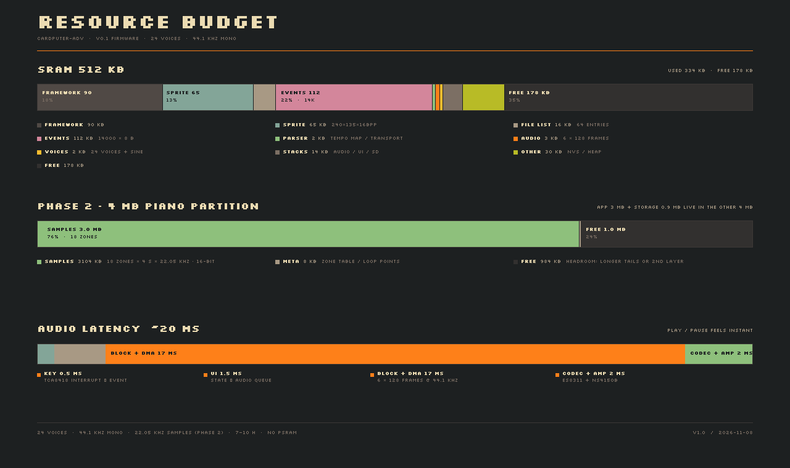
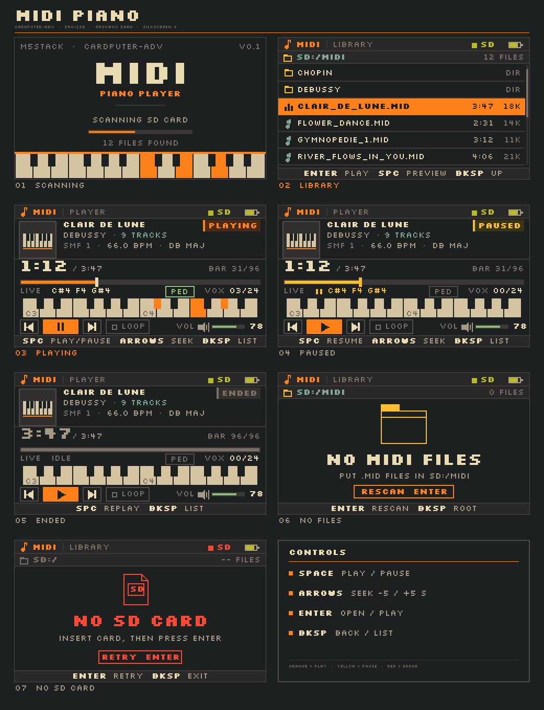
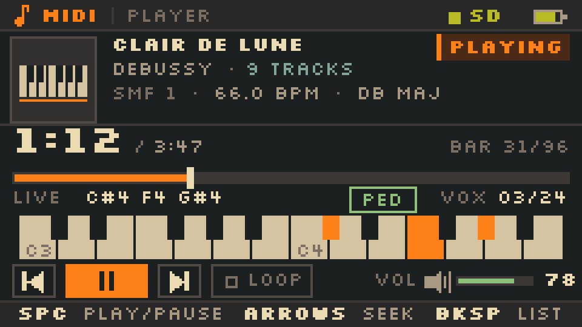
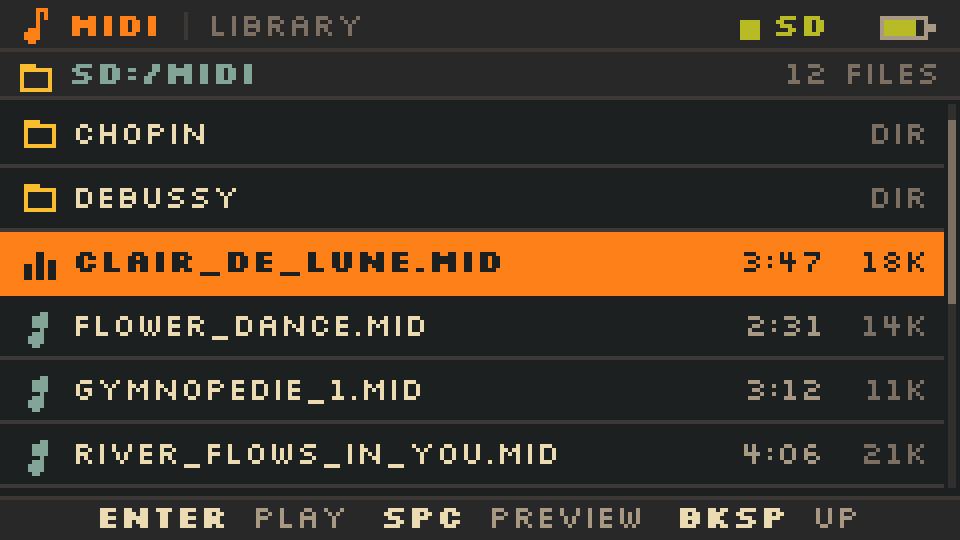

# 把 MIDI 播放器做进 Cardputer-Adv：可行性、方案与 Gruvbox 界面设计

> 目标：读 SD 卡里的 `.mid`，用钢琴音色播放 / 暂停。
> 设备：M5Stack Cardputer-Adv（ESP32-S3FN8，512 KB SRAM，8 MB Flash，无 PSRAM）。
> 日期：2026-11-08 · 版本：v1.0（评估 + 设计，不含固件实现）
>
> **2026-11-08 v0.1 固件已实现 Phase 1**：合成钢琴、SD 列表、播放/暂停/seek/循环；编译通过，待真机验证。实现与本文设计的差异：事件数组上限 14000（112 KB，替代流式窗口）、44.1 kHz 直连 I2S、音色为合成而非采样。详见 [`firmware/README.md`](firmware/README.md)。

---

## 0. 结论

| 问题 | 回答 |
|---|---|
| 能不能做 | **能，而且不需要改硬件。** 屏幕、键盘、SD、ES8311、1 W 喇叭都是现成的 |
| 难度 | **5.5 / 10**（有 ESP32 音频经验）· 7.5 / 10（从零开始） |
| 建议路线 | **Phase 1 流式合成钢琴（先把链路跑通）→ Phase 2 Flash 多采样钢琴（把音色做好）** |
| 工作量 | 合成版 MVP **60–90 h**；推荐的采样版 **110–160 h**；打磨到可发布 **180–220 h** |
| 最大瓶颈 | 音频欠载（实时流）> 钢琴音色 > tempo / seek 正确性 > SD 停顿 |
| 音质上限 | 1 W 单声道 + 22.05 kHz 采样 = “不错的便携琴”，**不是**钢琴；耳机口会明显更好 |
| 不建议 | 运行时解析 SoundFont、从 SD 实时流采样、堆混响、做音序器 |

一句话：**MIDI 解析本身是本科课程设计，真正的工作量在“把 24 个钢琴声部稳定地喂给 ES8311”和“让 4 MB 闪存里的钢琴采样听起来像钢琴”。**

---

## 1. 需求与边界

### 1.1 本期要做

- 开机扫描 SD 卡（`/MIDI` 起，可进子目录），列出 `.mid` / `.midi`
- 解析 SMF Format 0 / 1：note on/off、velocity、CC64 延音、CC7/CC11 音量、tempo、拍号、曲名、轨道名
- 钢琴音色，24 声部，带延音踏板、力度分层（滤波 + 增益）
- 播放 / 暂停 / 继续 / 停止；`←/→` 快退快进 5 s；上一首 / 下一首；单曲循环
- 全局音量，掉电保存（NVS）
- 240×135 Gruvbox Dark 界面，含文件列表、播放页、暂停态、结束态、无文件 / 无卡错误页
- 播放页实时显示：进度、总时长、BPM、调号、当前音符、声部数、踏板状态

### 1.2 明确不做（v1）

- MIDI 输入 / BLE MIDI / USB MIDI（后续可加）
- 录音、导出、音序器、轨道 mute/solo（这是 MPC 的活）
- 运行时 SF2 / DLS 解析（离线转成自己的格式）
- 多轨音色、鼓组、混响、合唱、立体声（ES8311 只有单声道 DAC）
- 中文界面与中文文件名渲染（P2，见 §10.8）
- 封面图、歌词、频谱（MIDI 里没有这些）

---

## 2. 硬件事实，以及它意味着什么

| 项目 | Cardputer-Adv | 对播放器的含义 |
|---|---|---|
| SoC | ESP32-S3FN8，2× LX7 @ 240 MHz，单精度 FPU | 24 声部 + 采样插值够用；不要用 `sinf` 堆 8 个泛音 × 24 声部 |
| SRAM | **512 KB，无 PSRAM** | 采样不能进 RAM；屏幕 sprite 固定吃掉 65 KB；所有大素材放 Flash |
| Flash | 8 MB | 划 3 MB app + **4 MB 钢琴采样** + 0.9 MB 杂项，刚好 |
| 屏幕 | 240×135 IPS，ST7789V2，SPI | 8 px 字体，一行 40 字符；全屏刷新 ~13 ms，必须做局部刷新 |
| 键盘 | 56 键，TCA8418 矩阵，中断 | 按键响应 <1 ms；但 FIFO 只有 10 个事件，UI 不能卡 |
| 音频 | ES8311 单声道 codec（8–48 kHz）+ NS4150B 1 W | 单声道、无 pan；输出用 32 kHz，codec 由 M5Unified 初始化 |
| 耳机 | 3.5 mm **单声道** | 音质明显好于喇叭；别在 UI 上画立体声电平表 |
| 存储 | microSD（SPI） | 顺序读够快；随机读 1–3 ms，卡内 GC 可到 100–250 ms → 必须预读/预扫描 |
| 电池 | 1750 mAh | 音频 + 屏幕约 150–220 mA，实测 **7–10 h**（70% 音量）；全音量 5–7 h |

规格依据：[CNX Software 的 Cardputer-Adv 报道](https://www.cnx-software.com/2025/10/23/m5stack-cardputer-adv-esp32-s3-computer-gains-improved-antenna-larger-1750-mah-battery-es8311-audio-codec/)、[M5Stack 官方文档](https://docs.m5stack.com/en/core/Cardputer-Adv)。上一版 MPC 评估里“无 PSRAM / 512 KB”的判断在这里同样成立，**不要把采样池设计在 RAM 里**。

### 2.1 三个硬约束

1. **RAM 只有 512 KB。** 一首 3 分钟的 22.05 kHz / 16-bit 单声道 PCM 是 7.9 MB，装不下；24 个声部同时解码也不能各开一个大缓冲。解法：采样放 Flash、mmap 直接读、每个声部只保留几十字节状态。
2. **单声道 1 W。** 钢琴最低几个八度的基频（27–65 Hz）基本出不来；靠耳机或外接音箱。UI 不要承诺“Hi-Fi”。
3. **没有力度。** Cardputer 键盘不是力度键盘；MIDI 文件里的 velocity 仍然要尊重（它决定音色亮度），但现场弹奏没有力度。这个项目只做播放，所以不是问题。

---

## 3. 系统架构

```text
音频路径
  microSD ─▶ SMF reader ─▶ Parser/tempo ─▶ Event queue ─▶ Scheduler ─▶ Piano engine ─▶ Mix/limit ─▶ I2S/ES8311 ─▶ 1 W / 3.5 mm
             4 KB 窗口      预扫描          256 × 16 B      采样级定时      24 voices       软限幅        32 kHz mono

素材
  Flash 4 MB (piano.bin, 18 zones) ── mmap ──▶ Piano engine

控制
  TCA8418 键盘 ──▶ UI / Transport ──▶ Scheduler（播放 / 暂停 / seek / 循环）
```

- 音频路径只认“样本时钟”，不认 `millis()`；UI 的按键、SD 的慢读都通过队列和控制命令进入。
- Parser 提前 1–2 秒把事件放进队列；队列是“提前量”，不是“缓冲整首”。
- 采样区在 Flash 里，Piano engine 通过 mmap 直接读；RAM 里只有 24 个声部的状态。

### 3.1 任务与核

| 任务 | 核 | 优先级 | 职责 |
|---|---|---|---|
| audio | 1 | 19 | 每 8 ms 生成 256 帧，处理块内事件，混音，软限幅 |
| ui | 0 | 5 | 20 fps 局部刷新，按键边沿检测，状态机 |
| parser | 0 | 4 | 预扫描、按块解析、把事件放进队列；SD 慢读不阻塞音频 |
| sd-scan | 0 | 3 | 开机目录扫描、时长缓存（可选） |

**音频线程绝不碰 SD、不碰 `malloc`、不碰 M5GFX。** 解析线程提前 1–2 秒把事件放进队列；队列空的时候音频线程只做混音。

### 3.2 为什么不用“整首渲染成 WAV 再播”

3 分钟 22.05 kHz / 16-bit 单声道 = 7.9 MB，SD 上放得下，但 RAM 放不下；如果从 SD 流 WAV，又会把“随机读延迟”引到音频路径上。实时合成/采样只需要几 KB 状态，且能暂停、seek、循环，是正确的结构。

---

## 4. MIDI：解析、定时、走带

### 4.1 支持的 SMF 子集

| 项目 | 处理 |
|---|---|
| `MThd` | 校验长度 6、format、ntrks、division |
| Format 0 / 1 | 支持；Format 2 提示“不支持”并退回列表 |
| Division | PPQ 支持；SMPTE（division & 0x8000）按帧率换算，也支持 |
| 运行状态 | 支持；遇到 `F0/F7/FF` 清除运行状态 |
| Note on / off | velocity 0 视作 note off；channel 10（鼓）默认跳过 |
| CC | 64 延音、7 音量、11 表情、120/121/123 全部关音；其余忽略 |
| Pitch bend | 支持 ±2 半音（便宜的频率乘子）；不做 RPN 微调 |
| Program change | 忽略（永远是钢琴） |
| Meta | tempo `51`、拍号 `58`、调号 `59`、曲名 `03`、轨道名 `04`、end `2F`；lyrics/marker 跳过 |
| SysEx | 跳过，不占 RAM |
| 异常 | 截断文件、长度越界、VLQ 超过 4 字节 → 报错，不崩溃 |

### 4.2 时间：从 tick 到 sample

```
us_per_tick = tempo_us_per_quarter / division
t_us       += delta_ticks * us_per_tick
sample      = t_us * 32000 / 1_000_000
```

- 全部用 **64 位整数微秒**，最后一步才换算成 sample，避免累积误差。
- tempo 是分段常数：每遇到 `51` 事件，更新后续的 `us_per_tick`；tempo map 按 tick 排序。
- 事件调度到 **块内偏移**：一个 256 帧的块里，note on 可以在第 0–255 帧的任意位置开始，不必把块切开。
- tempo map 用固定 256 项（4 KB）；超过就合并相邻项（误差 <1 ms），极端 rubato 文件也不会爆内存。

### 4.3 预扫描、时长、seek

**预扫描**（打开文件时一次，典型 30–100 ms）：

1. 走完所有轨道，累计 tick / 时间，得到总时长；
2. 统计音符数、轨道数、BPM 范围、调号；
3. 建 tempo map；
4. 记下“第一音符时间”，播放时从 0 开始还是跳过前奏空白（可选）。

**seek**（v1）：目标时间 → 用 tempo map 反查 tick → 从文件头重新解析到该 tick → 重置合成器。100 KB 的文件 <50 ms；1 MB 的密集文件 200–400 ms，显示 `SEEK` 徽标即可。v2 再考虑每 256 个事件建一个索引（`tick, us, offset, running status`），不值得为 v1 增加复杂度。

> **v0.1 实现选择**：固件先把整首的事件合成一个数组（最多 14000 个，112 KB），排序后换算成 µs；播放时按 2.9 ms 块边界触发。这样省掉了流式窗口/k-way merge 的复杂度，代价是超大文件会被拒绝（`TOO COMPLEX`）。流式 8 KB 窗口留到需要支持大文件时。

**暂停**：8 ms 淡出到静音，冻结音频时钟和包络，但 **I2S 继续跑静音块**；parser 同时暂停，避免队列在暂停期间被填满。恢复时先补 1–2 秒事件，再 8 ms 淡入。不要 `Speaker.stop()`——ES8311 重新起振会有咔哒声，而且恢复要 30–50 ms。

**停止 / 返回列表**：15 ms 淡出 + 全部音符 fast release，再清状态。

### 4.4 声部与踏板

- 24 声部；超出时偷 **释放态里最安静的**，否则偷最老的，5 ms 淡出防爆音。
- 同一 `(channel, note)` 的重叠 note-on 用栈配对；note-off 只关最后一个，避免前一个被提前掐断。
- `CC64 ≥ 64` 踩下：note off 不释放，标记 sustained；踏板抬起时统一释放。
- `CC7` / `CC11` 作为通道增益，作用在新音符和混音上；不做逐样本平滑（变化足够慢）。
- 换曲 / 停止 / seek：所有声部 100 ms release，不做硬切。
- 低音区音符衰减长，偷声部时优先保留低音（可选）。

### 4.5 解析器怎么测

- 用 Python `mido` 做参考，导出 `(tick, type, note, vel)` 时间线，和 C++ 解析结果逐行 diff；
- 语料：Bach WTC（Format 1、tempo 变化）、流行 MIDI（Format 0、running status）、带 SysEx 的文件、SMPTE 文件、截断文件、黑 MIDI（音符数上限）。
- 目标：50 个文件里 ≥95% 能播；解析失败只影响当前文件，不死机。

---

## 5. 钢琴音源：三条路线

| 方案 | 音色 | RAM | Flash | CPU | 工作量 | 结论 |
|---|---|---|---:|---:|---|---|
| **A. 加法/FM 合成** | 电钢 / 玩具钢琴 | ~4 KB | 0 | 15–25% 单核 | 2–3 天 | **Phase 1 用它跑通链路** |
| **B. Flash PCM 多采样** | 真实钢琴（ROMpler 级） | ~30 KB | ~3.2 MB | 6–10% | 1–1.5 周 | **推荐，Phase 2 目标** |
| C. Flash 4-bit ADPCM | 略差，有量化噪声 | ~50 KB | ~1 MB | 10–15% | +3–5 天 | 没必要，Flash 够 |
| D. SD 实时流采样 | 好 | 小 | 0 | 低 | 1 周 | **拒绝**：随机读延迟会毁掉 24 声部 |
| E. 外挂 VS1053 | 很好（GM 音源） | 小 | 0 | 极低 | 硬件改机 | 不建议，破坏一体性 |

### 5.1 推荐：Flash PCM，18 个区，22.05 kHz / 16-bit

- 音域 A0–C8（21–108），每 5 个半音一个采样区，共 **18 区**，最大移调 ±2.5 半音（听感可接受）。
- 每区 4.0 s，循环点 2.0 s → 3.9 s（1.9 s 循环），18 × 4 s × 44.1 KB/s = **3.18 MB**。
- 22.05 kHz 的奈奎斯特是 11 kHz；1 W 喇叭本来也到不了 15 kHz，耳机下略暗但可接受。
- 16-bit PCM 不做压缩：Flash 读取 24 声部 × 44.1 KB/s ≈ **1.06 MB/s**，mmap 缓存毫无压力；省掉 ADPCM 解码和量化噪声。
- 4 MB 分区里实际占 ~3.0 MiB，留 ~1.0 MiB 给更长的尾音或第二层力度。
- 循环点做 20 ms 等功率交叉淡化；循环段选在衰减较缓的位置，必要时给循环加 0.2–0.5 dB/s 的额外衰减，避免周期性起伏。释放段由包络合成，不需要 release 采样。

### 5.2 离线素材管线

```
SoundFont (.sf2) 或单音 WAV
  → Python: 选 preset / zone，读 root key、loop start/end
  → 重采样到 22.05 kHz（scipy polyphase，带抗混叠）
  → 截 4.0 s，循环点对齐过零，20 ms 交叉淡化
  → 归一化到 -1 dBFS，TPDF 抖动，写 16-bit LE
  → piano.bin + piano_zones.h（18 个 zone 的偏移/长度/loop/root/gain）
  → 烧到 Flash 0x310000，SHA256 写进头
```

素材来源（**发布前逐个核对许可证**）：

- FluidR3_GM SoundFont（Frank Wen，MIT，保留版权声明）——GM 钢琴，现成的 loop 点；
- Salamander Grand Piano（Alexander Holm，CC-BY 3.0）——音质更好，文件大，取子集；
- VSCO 2 Community Edition（CC0）——最省心，钢琴音色一般。

不要把商业音源转出来发布。仓库里放 `LICENSES/` 和出处。

### 5.3 声部播放

```
zone    = clamp((note - 21) / 5, 0, 17)
root    = 21 + zone * 5
step    = 2^((note - root)/12) * (22050 / 32000)
```

- 线性插值重采样（22.05k → 32k 输出）；音高比最大 1.155，重采样步长 = 0.689 × 音高比，约 **0.60–0.80**，低于 1 意味着“慢放”，不会因为读快而混叠。
- 每个声部只存：`zone, pos, loopStart, loopEnd, step, env, filter, note, vel` ≈ 64 B；24 声部 ≈ 1.5 KB。
- 力度：增益 `(vel/127)^1.6` + 一阶低通（截止 1.5–9 kHz），软音更暗、更小。
- 释放：note off 后 120–250 ms 指数衰减；踏板踩下时保持循环。
- 循环：`pos >= loopEnd` 时 `pos -= loopLen`，包络继续走。

### 5.4 Phase 1 的合成钢琴（fallback）

- 16 声部，4 个泛音（带轻微非谐性），指数衰减，5 ms 噪声起音，力度控制高次泛音；
- 512 点正弦表 + 线性插值；32 kHz；
- 听感是“电钢 / 玩具钢琴”，但能验证解析、调度、暂停、seek、UI 全链路；
- 也作为 **采样分区缺失/损坏时的降级音源**，保证机器永远能出声。

### 5.5 音质预期（说清楚）

- 喇叭：中频清楚，低音薄，高音刺；钢琴的“击弦感”有，但“琴体共鸣”没有。
- 耳机：明显更好，仍是单声道。
- 和手机上的 MIDI 播放器比差很多；和 50 美元电子琴的 GM 音源比，互有胜负。
- 想更好只能：加混响（P2）、加第二层力度采样（Flash 不够）、外接音箱。

---

## 6. 音频输出与实时性

### 6.1 M5Unified 的流式播放

M5Unified 的 `Speaker_Class` 已经提供运行时生成 PCM 的机制：

- `setBufferReleaseCallback(args, func)`：播放任务读完一块后回调，允许复用该缓冲；
- `playRaw(buf, 256, 32000, false, 1, 0, false)`：单声道、播一次、固定虚拟通道 0；
- 官方头文件明确写了“运行时生成的数据，两块交替 + release 回调就够了”。

实现：3 块 256 帧（8 ms）的 `int16_t` 缓冲，音频任务等“缓冲释放”信号，填下一块，再入队。`M5.Speaker.setVolume(255)`，音量自己做数字增益（对数曲线），避免 codec 音量步进。

> 已核对本仓库 `firmware/.pio/libdeps/cardputer/M5Unified/src/utility/Speaker_Class.hpp`，`setBufferReleaseCallback` / `playRaw` 的语义与上面一致。锁定 M5Unified 0.3.x，升级前重测。
>
> **v0.1 实现备注**：固件实际走了 **直连 I2S**（`i2s_driver_install` + ES8311 寄存器初始化，复用 `Cardputer_MPC` 的已验证路径），6×128 帧 @ 44.1 kHz；好处是 DMA/块大小完全可控，代价是 codec 和音量要自己管。M5Unified 流式方案保留为备选。

### 6.2 欠载预算

| 项目 | 数值 |
|---|---|
| 块大小 | 256 帧 @ 32 kHz = 8 ms |
| 缓冲余量 | 2–3 块 = 16–24 ms |
| 24 声部生成 256 帧 | ~0.3–0.6 ms（@240 MHz） |
| 解析/UI 干扰 | 不同核，不抢占音频 |
| 结论 | 余量 >10×，除非 UI 在音频核上跑或 SD 读进音频线程 |

如果还是听到周期性“嗒嗒”：把块降到 128 帧（4 ms）、加到 4 块、音频任务绑核 1、优先级 19；仍不行再走直连 I2S（`i2s_std` + `esp_codec_dev`，4×256 DMA）。直连的代价是要自己初始化 ES8311 和音量，工作量 +2–3 天。

### 6.3 主链路

```
voices sum → 软限幅 x/(1+|x|) → DC blocker → 音量 → int16
```

- 不做全局混响（P2 可加 4 comb + 2 allpass，~16 KB RAM / 5% CPU；1 W 喇叭下容易糊）。
- 淡入淡出 5–10 ms，防止暂停/恢复/seek 的咔哒。
- 音量曲线：`gain = (vol/100)^2`，NVS 保存，掉电恢复。

### 6.4 延迟

| 环节 | ms |
|---|---:|
| 按键中断 → 事件 | 0.5 |
| UI → 音频任务 | 0.5–2 |
| 块 + DMA | 8–16 |
| ES8311 + 功放 | ~1 |
| **合计** | **~12–22 ms** |

播放/暂停的手感是“立即”，seek 的重新解析另算（<50 ms 典型）。

---

## 7. 资源预算



### 7.1 RAM（512 KB）

| 项目 | KB | 说明 |
|---|---:|---|
| 框架 / 静态 | 90 | IDF + Arduino + M5Unified + 任务控制块 |
| 显示 sprite | 65 | 240×135×16bpp |
| 文件列表 | 16 | 64 项 × 144 B（路径、大小、时长、flags） |
| MIDI 事件数组 | 112 | 14000 × 8 B（note on/off + CC64） |
| tempo / 状态 | 2 | 256 项 tempo map + 走带 |
| 音频缓冲 | 3 | 6 个 DMA 缓冲 + 混音临时 |
| 声部状态 | 2 | 24 × 64 B + 正弦表 |
| 任务栈 | 14 | audio 6 + ui 6 + parser/sd 2 |
| 其他 / 碎片 | 30 | NVS、日志、堆开销 |
| **合计** | **~334** | 余量 ~178 KB，足够 |

### 7.2 Flash（8 MB）

| 分区 | 大小 | 内容 |
|---|---:|---|
| bootloader / 分区表 | 32 KB | 固定 |
| app0 | 3 MB | 固件（实际 ~1.3–1.6 MB） |
| piano | **4 MB** | 18 区 PCM + 头 + SHA256（实占 ~3.0 MiB） |
| storage | 0.875 MB | 配置、索引缓存、许可证 |
| coredump | 64 KB | 崩溃转储 |

```csv
# Name,   Type, SubType, Offset,   Size
nvs,      data, nvs,     0x9000,   0x5000
otadata,  data, ota,     0xE000,   0x2000
app0,     app,  ota_0,   0x10000,  0x300000
piano,    data, 0x40,    0x310000, 0x400000
storage,  data, spiffs,  0x710000, 0x0E0000
coredump, data, coredump,0x7F0000, 0x10000
```

- `piano` 用自定义子类型 `0x40`，`esp_partition_find_first()` 找到后 `esp_partition_mmap()` 直接读；不挂文件系统。
- 烧录：`piano.bin` 追加到合并镜像的 `0x310000`，或单独 `esptool write_flash 0x310000 piano.bin`；开机校验头里的 magic / 版本 / SHA256，坏了就降级到合成音源并提示。

### 7.3 CPU

- 24 声部 × 32 kHz × 约 25 周期/样本 = **19 M cycles/s ≈ 8%**（单核 240 MHz）。
- 解析 + UI + 刷屏：<10%。
- 峰值（密集段落 + 局部刷新）：25–35%，双核下很宽松。

### 7.4 SD

- 顺序读 1–2 MB/s；一首 100 KB 的 MIDI 预扫描 <0.1 s。
- 播放时解析线程提前读 4 KB 块；MIDI 事件本身很稀疏，8 KB 窗口能撑很久。
- 卡内 GC 100–250 ms：因为音频线程不读 SD，最多是“事件晚到”，不会欠载；如果队列见底，宁可重复上一 tempo 的静音，也不要阻塞音频。

### 7.5 功耗

| 状态 | 电流 | 1750 mAh 续航 |
|---|---:|---:|
| 列表 / 待机 | 45–70 mA | 20 h+ |
| 播放，70% 音量 | 150–220 mA | 7–10 h |
| 播放，100% 音量 + 重低音 | 250–320 mA | 5–7 h |

WiFi/BLE 关闭；屏幕亮度 60%；CPU 240 MHz（降频到 160 MHz 也可以，但音频余量变小）。

---

## 8. 风险与对策

| # | 风险 | 概率 | 影响 | 对策 |
|---|---|---|---|---|
| 1 | 音频欠载 / 咔哒 | 中 | 高 | 3 缓冲 + release 回调 + 音频绑核；直连 I2S 作为 plan B |
| 2 | 钢琴音色“假” | 高 | 高 | 直接上 Flash 采样，不要用合成音源做最终版；耳机口 |
| 3 | tempo / seek 算错 | 中 | 高 | 64 位微秒、mido 对照、语料回归；seek 用重解析 |
| 4 | SD 停顿 | 中 | 中 | 预扫描、8 KB 窗口、解析线程低优先级、音频不碰 SD |
| 5 | 密集 MIDI 爆声部 | 中 | 中 | 24 声部 + 偷声部 + 音符数上限（50k），超限提示 |
| 6 | 分区 / 烧录复杂 | 低 | 中 | 合并 bin、SHA256 校验、缺分区降级 |
| 7 | 采样许可证 | 中 | 高 | 只用 MIT/CC0/CC-BY，仓库放 LICENSE 与出处 |
| 8 | 中文文件名 | 高 | 低 | v1 用 ASCII 替换 `?`；P2 加 12 px CJK 子集 |
| 9 | M5Unified API 变化 | 低 | 中 | 锁定 0.3.x；封装 `AudioSink` 接口 |
| 10 | 1 W 喇叭低频差 | 高 | 中 | UI/文案不承诺 Hi-Fi；建议耳机；EQ 低架 +2 dB（可选） |

---

## 9. 计划、工作量、验收

### 9.1 里程碑

| 阶段 | 内容 | 人时 | 产出 |
|---|---|---:|---|
| M0 | 工程骨架、SD 列表、屏幕/键盘、静态 UI | 8–12 | 能进列表、能看到播放页 |
| M1 | SMF 解析 + 预扫描 + 走带 + 合成音 | 24–32 | 能播 Format 0/1，暂停/seek 可用 |
| M2 | 钢琴合成 16–24 声部、踏板、偷声部 | 20–28 | 音乐上可用，验证实时性 |
| M3 | Flash 采样引擎 + 分区 + 转换脚本 | 32–40 | 真实钢琴音色 |
| M4 | UI 打磨、错误态、循环、NVS、设置 | 20–28 | 可日常使用 |
| M5 | 语料回归、功耗、文档、发布 | 12–20 | v1.0 |
| **合计** | | **110–160** | 合成版可提前在 M2 截断（60–90 h） |

按每周 20 h 算：**6–8 周**；全职 3–4 周。

### 9.2 验收标准

- 50 个 MIDI 语料中 ≥95% 能播；Format 2 / 损坏文件有明确提示。
- 24 声部，连续 30 分钟无 >5 ms 的断续；暂停/恢复无 >-60 dBFS 的咔哒。
- seek ±5 s 的落点误差 <50 ms；暂停位置误差 <1 个块。
- 100 个文件开机到列表 <2 s；Enter 到第一个音 <150 ms。
- 50 次打开/关闭文件后 free heap 下降 <4 KB。
- 70% 音量续航 ≥6 h；机身不烫手（<45 °C）。
- 采样分区缺失时能降级发声并提示，不死机。

---

## 10. UI 设计（Gruvbox Dark）



设计稿按 **240×135 的 1× 像素**绘制，`design/out/*.png` 是 4× 最近邻放大；所有坐标都是整数，1 px 描边，无圆角、无渐变、无抗锯齿。

### 10.1 为什么是 Gruvbox Dark

- 暖灰底（`#1D2021`）+ 米色字（`#EBDBB2`）在 1.14" IPS 上不刺眼，长时间读列表舒服；
- 橙色（`#FE8019`）只给“走带 / 选中 / 正在播放”，一眼能找到主操作；
- 黄色只给“暂停 / 警告”，红色只给“错误 / 无卡”，绿色只给“SD/电量正常”——不靠颜色猜状态；
- 和已有的 MusicTools / MPC 设计语言连续，字体、描边、状态栏都能复用。

### 10.2 界面一览

| 图 | 界面 | 关键信息 |
|---|---|---|
| `01-splash.png` | 开机扫描 | 品牌、SD 扫描进度、文件数 |
| `02-library.png` | 文件列表 | 路径、文件夹/文件、时长、大小、选中、播放标记 |
| `03-player.png` | 播放中 | 曲名、作曲家/轨道数、SMF/BPM/调号、进度、实时音符、2 个八度键盘、走带、音量 |
| `04-paused.png` | 暂停 | 黄色徽标/进度、`II` + 保持的音符、恢复提示 |
| `05-ended.png` | 播完 | 灰色 `ENDED`、满进度、`REPLAY` |
| `06-no-files.png` / `07-no-sd.png` | 空状态 | 明确原因 + 一个动作（RESCAN / RETRY） |

#### 播放页（主界面）



从上到下 7 条带：

| 区域 | Y | 高 | 内容 |
|---|---:|---:|---|
| 顶栏 | 0–12 | 13 | 音符 logo、`MIDI`、`PLAYER`、SD 状态、电量 |
| 曲目头 | 13–50 | 38 | 36×36 钢琴图块、曲名、`DEBUSSY · 9 TRACKS`、`SMF 1 · 66.0 BPM · DB MAJ`、右侧 `PLAYING` 徽标 |
| 进度 | 51–76 | 26 | 16 px 大号 `1:12`、`/ 3:47`、`BAR 31/96`、5 px 进度条 + 播放头 |
| 实时 | 77–88 | 12 | `LIVE`、当前音符 `C#4 F4 G#4`、`PED`、`VOX 03/24` |
| 键盘 | 89–107 | 19 | C3–B4 两个八度，14 个白键 × 16 px，按下的键橙色 |
| 走带 | 108–123 | 16 | 上一首、播放/暂停（橙色大按钮）、下一首、LOOP、VOL |
| 底栏 | 124–134 | 11 | `SPC PLAY/PAUSE`、`ARROWS SEEK`、`BKSP LIST` |

设计要点：

- **大号时间 + 进度条**是主视觉；不画专辑封面（MIDI 没有），用钢琴键图块建立身份。
- **实时键盘**比钢琴卷帘更适合 135 px 高：一眼看到现在按了哪些音，也能看出音区。音符超出 C3–B4 时窗口按八度平移（200 ms 迟滞），不会“跑到屏幕外”。
- **`PED`** 是延音踏板状态，`VOX` 是当前声部数 / 上限；这两个数字对“为什么声音糊了”很有解释力。
- **暂停**不弹整屏遮罩：只把徽标、进度条、保持音符变黄，播放键变回三角，信息不丢。
- **播完**变灰，播放键变 `REPLAY`，不自动跳下一首（避免夜深人静突然响）。

#### 文件列表



- 6 行 × 16 px，路径条 12 px；行内：图标 8×8、文件名、时长（右对齐 206）、大小（右对齐 232）。
- 时长不是开机全量扫描：选中行时后台预扫描一次（30–100 ms），按 `路径 + mtime` 缓存；没扫过的行显示 `--:--`，保证 100 个文件也能 2 s 内进列表。
- 选中行整行橙色反白（`#FE8019` 底、`#1D2021` 字），正在播放的文件用 3 根小柱子的图标标记；即使光标移走，播放行仍保持橙色文字 + 柱子。
- 文件夹黄色、MIDI 文件蓝色；`DIR` 在大小列。
- 右侧 2 px 滚动条，只在内容溢出时出现。
- 底部 `ENTER PLAY · SPC PREVIEW · BKSP UP`。

#### 空状态

没有 `.mid` 和没有 SD 卡是两种问题，给两种界面、两个动作；不要用一句 “ERROR” 糊过去。空状态也给路径，让用户知道该往哪放文件。

### 10.3 状态与语义色

| 状态 | 徽标 | 进度条 | 播放键 | 键盘 |
|---|---|---|---|---|
| 播放 | `PLAYING` 橙 | 橙 | `II` | 按下的键橙 |
| 暂停 | `PAUSED` 黄 | 黄 | `▶` | 全灭，`II` + 音符黄 |
| 结束 | `ENDED` 灰 | 灰满 | `▶`（REPLAY） | 全灭 |
| 加载 | `LOADING` 蓝 | 不确定/空 | 禁用 | 全灭 |
| 错误 | `BAD MIDI` 红 toast | — | — | — |

### 10.4 按键

Cardputer 的方向键是 `Fn` 层：`Fn+;` 上、`Fn+,` 左、`Fn+.` 下、`Fn+/` 右。

| 场景 | 键 | 动作 |
|---|---|---|
| 列表 | `Enter` | 进目录 / 播放 |
| 列表 | `Space` | 试听当前文件（8 s，再按停止） |
| 列表 | `Fn+;` / `Fn+.` | 上 / 下选择 |
| 列表 | `Fn+,` | 返回上级 |
| 列表 | `Fn+/` | 进目录 |
| 列表 | `Backspace` / `` ` `` | 上级 / 根目录 |
| 播放 | `Space` / `Enter` | 播放 / 暂停 |
| 播放 | `Fn+,` / `Fn+/` | 快退 / 快进 5 s（按住连发） |
| 播放 | `Fn+;` / `Fn+.` | 音量 +5 / −5 |
| 播放 | `,` / `.` | 上一首 / 下一首 |
| 播放 | `L` | 单曲循环开 / 关 |
| 播放 | `Backspace` | 停止并返回列表 |
| 全局 | `-` / `=` | 音量 −10 / +10（列表页弹 1.2 s OSD） |

按住连发：首次 400 ms，之后 12 次/s；`Fn` 组合键用 `M5Cardputer.Keyboard` 的 `fn` 状态判断，不要自己猜矩阵。

### 10.5 刷新策略

- 整屏只在 **换页** 时重画（sprite 一次 push，240×135×16bpp = 65 KB，40 MHz SPI 约 13 ms）。
- 播放页只刷：
  - 时间数字（5,53,48×11）和进度条（5,69,230×9）；
  - `LIVE` 音符文本（35,79,100×8）；
  - 变化的琴键（16×18 或 7×10 的小块）；
  - 徽标（状态切换时）；
  - 音量条。
- 目标 20 fps；进度条实际 10 fps 就够。
- 所有绘制先到 `M5Canvas`，再 `pushSprite` 局部区域；不要直接画屏，避免撕裂。

### 10.6 字体与文案

- Silkscreen 8 px（SIL OFL 1.1），只有大写；Regular 正文 6 px/字符，一行 40 字符（Bold 更宽，按实测排）；数字等宽，时间不会跳。
- 16 px 给大号时间和空状态标题；32 px 只给开机 `MIDI`。
- 文案用英文：8 px 下中文需要 12–16 px 点阵，240 px 一行只能放 15–20 字，且要额外 100–200 KB 字库。标题/文件名优先保证信息密度，P2 再考虑中文 UI。
- 文件名超长：中间截断，保留扩展名，如 `RIVER_FLOWS..MID`；曲名（meta）可 30 px/s 走马灯。

### 10.7 可访问性

- 状态不只靠颜色：徽标有文字，播放键有 `II` / `▶` 图标，踏板有 `PED` 文字。
- 正文 `#EBDBB2` on `#1D2021` 对比度约 10:1；橙色约 5.5:1；`FAINT` 只用于次要提示。
- 最小可点击区域（如果以后换触摸屏）≥ 24×24；当前是键盘，不涉及。

### 10.8 中文文件名（P2）

FATFS 返回 UTF-8，M5GFX 内置字体没有 CJK。v1 把非 ASCII 显示为 `?`，并在列表底部提示 `NON-ASCII NAME`；P2 用 12 px Noto Sans SC 子集（常用 3500 字，约 120–180 KB）放 Flash，按需渲染，接受列表刷新变慢。

---

## 11. 不建议做的事

1. **运行时解析 SF2**：几 MB 的 bank、zone、generator，RAM 和代码量都不划算；离线转成 18 个区就够了。
2. **从 SD 实时流钢琴采样**：24 个声部同时随机读，卡内 GC 一次就够毁掉一首曲子。
3. **用 `M5.Speaker.playRaw` 一次塞整首**：3 分钟 7.9 MB，RAM 装不下；必须流式。
4. **在音频线程里刷屏 / 读 SD / `printf`**：任何一次 100 ms 的阻塞都会变成可听见的断音。
5. **给 1 W 喇叭加大量混响**：只会更糊；要加也只做很小的 room。
6. **做钢琴卷帘 / 音序器**：135 px 高、240 px 宽，信息密度不够；这是下一个项目（MPC）的事。

---

## 12. 参考

- [M5Stack Cardputer-Adv 官方文档](https://docs.m5stack.com/en/core/Cardputer-Adv)
- [CNX Software：Cardputer-Adv 规格与升级点](https://www.cnx-software.com/2025/10/23/m5stack-cardputer-adv-esp32-s3-computer-gains-improved-antenna-larger-1750-mah-battery-es8311-audio-codec/)
- [MD_MIDIFile（Arduino 流式 SMF 库，可作解析参考）](https://docs.arduino.cc/libraries/md_midifile/)
- [M5Unified `Speaker_Class`（流式缓冲 / release 回调）](https://github.com/m5stack/M5Unified/blob/master/src/utility/Speaker_Class.hpp)
- [FluidR3_GM SoundFont（MIT，需保留版权声明）](https://sources.debian.org/data/main/f/fluidr3mono-gm-soundfont/2.315-7/FluidR3Mono_License.md)
- [Salamander Grand Piano（CC-BY 3.0）](https://archive.org/details/SalamanderGrandPianoV3)
- 本仓库既有实现：`firmware/src/ui.cpp`（M5GFX sprite / 240×135 布局）、`firmware/src/audio.cpp`（`playRaw` 用法）、`../Cardputer_MPC/design/`（Gruvbox 设计语言与渲染脚本）

---

## 附录 A：建议的代码结构

```
src/
  main.cpp          setup / 状态机 / 按键
  ui.cpp/.h         列表、播放页、错误页、局部刷新
  midi_file.cpp/.h  SMF 读取、VLQ、运行状态、tempo map
  transport.cpp/.h  播放时钟、暂停、seek、循环
  piano.cpp/.h      声部分配、包络、踏板、混音
  piano_sample.cpp  Flash 分区、zone 表、重采样
  audio_out.cpp     M5Unified 流式 / 直连 I2S 封装
  storage.cpp/.h    SD 扫描、路径、时长缓存
  config.cpp/.h     NVS 音量/循环/上次目录
tools/
  sf2_to_piano.py   素材转换
  make_piano_bin.py 分区镜像 + SHA256
```

## 附录 B：设计文件

- `design/out/00-overview.png` — 7 屏 + 控制卡（2×）
- `design/out/01-splash.png` … `07-no-sd.png` — 单屏 4×
- `design/out/palette.png` — 调色板与 Hex
- `design/ui-spec.md` — 像素级规格（坐标、组件、状态、刷新）
- `design/render_ui.py` — 可复现的设计稿渲染脚本（Pillow + Silkscreen）
